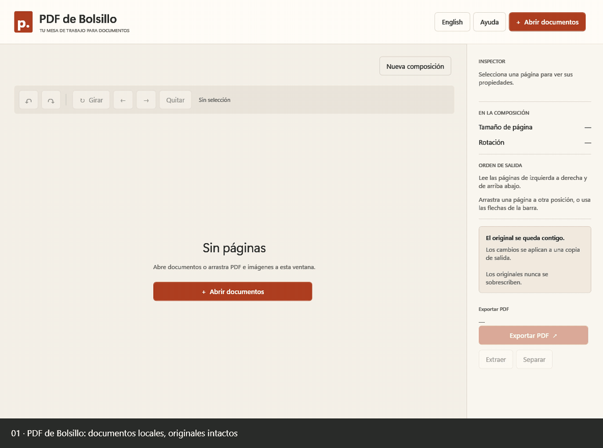

# PDF de Bolsillo
Aplicación gratuita y local para Windows, creada en C# / WPF para Ivan Solano. Versión **0.2.1**. Aplicación y publicación aprobadas por su autor.

Demo automatizada de la interfaz real a **2×**, con archivos sintéticos. Incluye selección, giro, reordenamiento, ampliación, cambio de idioma y configuración de exportación. Los cinco PDF generados durante la grabación se verificaron; los originales conservaron su contenido.

Repositorio: https://github.com/wasatnight/PDF-de-Bolsillo

## Abrir el código en Visual
- **VS Code:** abre PDF-de-Bolsillo.code-workspace, instala la extensión C# recomendada y pulsa F5.
- **Visual Studio:** abre PDF-de-Bolsillo.sln en una versión compatible con .NET 10.
- Requiere SDK .NET 10.0.402 o parche compatible; no incluye el SDK en el código fuente.

## Ejecutar
Abre **app/PdfDeBolsillo.exe**. Conserva todos los archivos de app juntos: incluye .NET, no requiere instalar SDK ni conexión a Internet.

Desde PowerShell, situado en esta carpeta:
    .\app\PdfDeBolsillo.exe

Windows x64 con soporte de .NET 10; recomendado Windows 11 actualizado. Usa las API PDF de Windows (contratos mínimos 10.0.19041). No se ha probado en otra computadora.

## Usar las funciones
1. Abre PDF, JPG o PNG, o arrástralos a la ventana. Cada importación se añade al final.
2. Selecciona con clic, Ctrl+clic o Mayús+clic. Doble clic o Enter amplía la página.
3. Mueve con arrastrar o los botones de flecha. Gira o quita páginas de la composición.
4. **Exportar PDF** permite guardar la composición completa (unir).
5. **Extraer** acepta la selección actual o números: 1, 3, 5-8.
6. **Separar** crea un archivo por página o un archivo por rango: 1-3, 4-6.
7. Las imágenes se pueden exportar en A4 vertical/horizontal o tamaño adaptado, con márgenes de 0 a 70 mm. Se conservan proporciones y se aplica orientación EXIF.

Los rangos usan la **posición actual de salida**, de izquierda a derecha y de arriba abajo. El inspector indica esa posición. No son necesariamente los números originales del PDF. Se rechazan páginas fuera del documento, rangos invertidos, repeticiones y superposiciones.

**Nueva composición** descarta la composición y su historial con confirmación; los originales no cambian. Historial de hasta 30 acciones. Ctrl+Z/Ctrl+Y deshacen/rehacen; Ctrl+R gira; Supr quita; Alt+flechas mueve. Esc cancela una tarea o cierra el diálogo.

English/Español cambia los controles, ayuda, avisos y previsualización sin perder cambios. Los nombres y el contenido de documentos no se traducen. Idioma por sesión, español al iniciar.

## Archivos y seguridad
Los documentos se copian a una carpeta temporal propia de sesión. La app solo lee los originales. Antes de exportar pide destino, bloquea rutas originales y confirma reemplazos de salidas existentes.

Cada resultado se escribe primero a un temporal junto al destino y se publica al terminar. En lotes se preparan todos los resultados antes de publicarlos; si falla la publicación, se intenta revertir el lote. Si una reversión no fuera posible, se informa y se conservan respaldos. No existe una transacción única del sistema de archivos entre varios PDF ni protección ante un apagado abrupto.

Cancelar detiene antes de publicar; los pasos nativos de lectura, guardado y la fase corta de publicación pueden tener que finalizar antes de atender la cancelación. La app no considera una salida parcial como éxito. Si cierras durante una tarea, la primera pulsación solicita cancelación.

No hay red, servicios de traducción, telemetría ni logs de contenido documental en el código de la aplicación. Los temporales se limpian al cancelar, fallar y cerrar normalmente. Un cierre forzado puede dejar copias en la carpeta PdfDeBolsillo de la carpeta temporal de Windows.

## Limitaciones documentales
PDF cifrados o restringidos se rechazan, incluso si se abren sin pedir contraseña. No se solicitan ni se intentan eludir contraseñas.

La salida es una nueva composición de páginas. **Se omiten campos de formulario y firmas interactivas; sus valores o apariencias pueden perderse. Las firmas digitales no se conservan como válidas.** No se garantiza conservar marcadores, otras anotaciones, etiquetas de accesibilidad ni metadatos. La app presenta el aviso antes de exportar PDF. Usa el original cuando necesites esos elementos.

No incluye OCR, edición de texto, firma digital ni compresión avanzada. Límites iniciales: 100 archivos por importación, 2000 páginas por composición, 256 MB por archivo y 40 megapíxeles por imagen. Las miniaturas muestran el contenido original y el giro de composición; los márgenes y el formato de imágenes se aplican al exportar.

## Ejemplos
La carpeta ejemplos contiene dos PDF ordinarios, imágenes de distintas proporciones y casos específicos: Rotado, Formulario, Protegido, Restringido y Dañado. Estos últimos son archivos sintéticos para verificar errores; no contienen datos personales. Los originales tienen hashes de referencia en hashes-originales.json.

## Desarrollar en VS Code
Requiere SDK .NET 10.0.402 (o parche compatible de esa banda), fijado en global.json. Extensión C# opcional; no requiere Visual Studio. Internet para restaurar paquetes.

    dotnet restore .\src\PdfDeBolsillo\PdfDeBolsillo.csproj --configfile .\NuGet.Config -r win-x64 --locked-mode
    dotnet run --project .\src\PdfDeBolsillo\PdfDeBolsillo.csproj
    dotnet publish .\src\PdfDeBolsillo\PdfDeBolsillo.csproj -c Release -r win-x64 --self-contained true -o .\app

También puedes ejecutar tools/Compilar.ps1. Publica la app autocontenida y copia los avisos legales desde third_party/licenses.

## Arquitectura y licencias
- MainWindow / ExportWindow / PagePreviewWindow: vistas y coordinación de tareas.
- ViewModels/WorkspaceViewModel: composición, selección, historial y comandos MVVM.
- Files/DocumentSession y PathSafety: copias, recursos y validación de rutas.
- Services/PdfExportService y PageRanges: composición, escritura temporal y rangos.
- Services/ThumbnailService e ImageLoader: renderer de Windows, caché de 48 miniaturas y orientación de fotos.
- Services/Localizer y Localization/Strings.json: catálogo bilingüe local.

PDFsharp-WPF 6.2.2 se fija bajo MIT. El renderizado lo resuelve Windows.Data.Pdf, no PDFsharp. Condiciones y versiones en docs/DEPENDENCIAS.md; avisos redistribuidos en app/licencias.

## Verificaciones
Ejecuta tools/Verificar.ps1 para generar un conjunto nuevo de pruebas sin tocar tus documentos. Las pruebas usan exclusivamente ejemplos y guardan resultados en .verification-runs. Requiere permiso de escritura en esta carpeta, no SDK.

Informes de esta entrega en docs/verificacion-funcional.json, verificacion-independiente.json y auditoria-nuget.json. Fueron revisados también el selector real, la exportación desde la interfaz y renderizados de Poppler. La validación automática no sustituye tu prueba manual ni constituye aprobación funcional.

## Código y distribución
El código propio no tiene todavía una licencia de reutilización elegida por el autor. Las dependencias conservan sus licencias y avisos en third_party/licenses. El programa se ofrece gratuitamente.

La grabación de desarrollo es opcional: tools/DemoRecorder.cs solo se incluye al compilar con -p:RecordDemo=true. No forma parte del comportamiento del ejecutable normal. Las capturas de la demo son superficies WPF, nunca el escritorio ni documentos personales.
